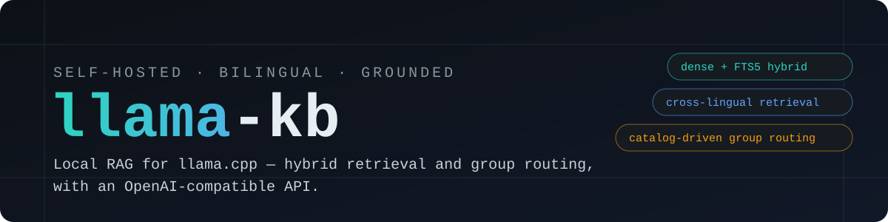
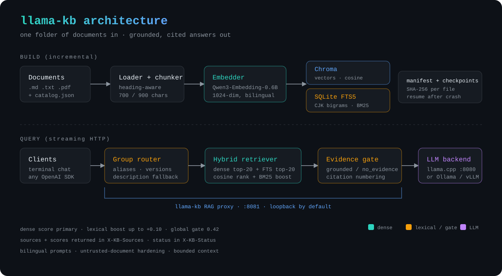

<div align="center">



**Local, bilingual RAG for llama.cpp** — group-aware hybrid retrieval with a drop-in OpenAI API.

[](https://github.com/RDXww/llama-kb/actions)
[](LICENSE)
[](pyproject.toml)
[](CONTRIBUTING.md)

[Quick start](#quick-start) · [How it works](#how-it-works) · [Groups](#document-groups) · [HTTP API](#http-api) · [Configuration](#configuration) · [中文](README.zh-CN.md)

</div>

---

llama-kb turns a folder of Markdown, text, and PDF files into a grounded Q&A
service on top of [llama.cpp](https://github.com/ggerganov/llama.cpp). It
combines **dense vector search** with **SQLite FTS5 keyword search**, routes
questions across **document groups** (C vs C++, a product manual vs an ops
runbook), and exposes everything through an **OpenAI-compatible proxy** — so
your existing chat client, SDK, or editor can use your private documents
without sending them anywhere.

## Why llama-kb?

- **Local-first.** Documents, embeddings, and answers stay on your machine.
  The proxy binds to `127.0.0.1` by default.
- **Bilingual, not bolted on.** Chinese and English documents live in one
  index. Ask in Chinese about an English runbook (or vice versa) and get an
  answer in the language you asked.
- **Group-aware routing.** A catalog describes groups, aliases, versions, and
  source prefixes. `C` questions are not polluted by `C++` docs and a Docker
  question can pick the right Docker version. You can always pin a group with
  `doc` / `X-KB-Doc`.
- **Hybrid retrieval that behaves.** Dense cosine similarity ranks candidates;
  FTS5 provides a bounded lexical boost for exact terms such as
  `strtok_s`, port numbers, and version strings. Group routing, per-source
  diversity, and evidence gating keep unrelated chunks out of the prompt.
- **Works at real corpus sizes.** Chunking, embedding, and FTS5 indexing are
  incremental: files are tracked by SHA-256, builds checkpoint every 500 files,
  and an interrupted build resumes instead of starting over. The reference
  deployment indexes **895,910 chunks across 74 groups** with retrieval under a
  second once loaded.
- **Honest when it doesn't know.** If retrieval finds no credible evidence,
  the model may still answer from general knowledge, but the response is
  marked `X-KB-Status: no_evidence` and starts with a clear disclaimer.
  Unsupported document groups are refused rather than answered from a similar
  source.
- **Drop-in.** Ships an OpenAI-compatible `/v1/chat/completions` endpoint with
  streaming, citations in `X-KB-Sources`, terminal chat, and CLI tools. Works
  with llama.cpp, Ollama, LM Studio, vLLM, or any OpenAI-compatible backend.

## Quick start

Requirements: Python 3.10+, `llama-server` on `PATH`, and a GGUF model. (You
can also skip llama.cpp and attach to an already-running OpenAI-compatible
backend.)

```bash
git clone https://github.com/RDXww/llama-kb.git
cd llama-kb

python3 -m venv .venv
source .venv/bin/activate
pip install -e ".[devdocs]"

KB_MODEL=/path/to/your-model.gguf ./scripts/start.sh
```

> No GPU? Install CPU-only PyTorch first to avoid pulling CUDA wheels:
> `pip install torch --index-url https://download.pytorch.org/whl/cpu`.

On first run, llama-kb:

1. downloads the multilingual embedding model
   (`Qwen/Qwen3-Embedding-0.6B`, about 1.2 GB) into
   `~/.cache/llama-kb/embedding`;
2. seeds `~/.llama-kb/docs` with the four original demo documents and copies
   `~/.llama-kb/catalog.json` (replace both with your own corpus);
3. builds a Chroma vector index plus a SQLite FTS5 index;
4. starts `llama-server`, the RAG proxy, and the terminal chat.

Already using Ollama (or any other OpenAI-compatible server)? Attach instead:

```bash
KB_LLAMA_URL=http://127.0.0.1:11434 ./scripts/start.sh --no-llama
```

Other launcher modes:

```bash
./scripts/start.sh --no-chat     # services only
./scripts/start.sh --rebuild     # full re-embed of all documents
./scripts/start.sh --no-build    # serve an existing index
```

> If Hugging Face is unreachable, set `LLAMA_KB_USE_HF_MIRROR=1` before the
> first run to download through `hf-mirror.com`.

### Add your own documents

Put `.md`, `.markdown`, `.txt`, and text-layer `.pdf` files under
`~/.llama-kb/docs` (subdirectories are fine). Then edit
`~/.llama-kb/catalog.json` to describe groups, and rebuild:

```bash
python -m llama_kb.cli build --if-needed
python -m llama_kb.cli search "how do I rotate the admin token?" --doc ops
```

Files are re-embedded only when their SHA-256 changes. Deleted files are
removed from both indexes. A scanned PDF without a text layer is reported and
skipped; OCR is not included.

To point at a different corpus without touching your default data:

```bash
KB_DOCS_DIR=./my-docs KB_CATALOG=./my-catalog.json \
KB_DB_DIR=./my-index python -m llama_kb.cli build
```

## How it works



At query time:

1. **Route.** The catalog checks aliases and version hints; follow-up questions
   inherit the previous group; a description-embedding comparison is the
   fallback. If no group is obvious, all preferred groups are searched.
2. **Retrieve.** Dense top-20 and FTS5 top-20 candidates are merged. Dense
   cosine score is the primary rank; normalized BM25 adds at most `0.10`.
   Results are diversified per source and capped at 6 chunks / 4,200 chars.
3. **Gate.** Weak hits are not injected. A pinned-group search needs a dense
   score of `0.26`; a global fallback needs `0.42`. Below that the request is
   marked `no_evidence`.
4. **Prompt.** Numbered references are injected with source, group, section,
   and page metadata. The system prompt treats references as untrusted data,
   forbids invented versions/ports/commands, and enforces the answer language.
5. **Stream.** The proxy forwards SSE and attaches sources and status headers
   to the response.

The design trade-offs (why BM25 is a boost rather than an RRF peer, why
serving embeddings stay on CPU, how the gates were tuned) are documented in
[docs/architecture.md](docs/architecture.md).

## Document groups

A group is any logically separable corpus — a programming language, a product,
a version of a manual, or a team's runbooks. Groups live in a single JSON
catalog:

```json
{
  "id": "ops",
  "name": "Operations Runbooks",
  "type": "knowledge_base",
  "sources": ["runbooks/gateway.md", "runbooks/aurora.md"],
  "aliases": ["ops", "runbook", "gateway", "AuroraDB", "运维"],
  "description": "Operations runbooks for the gateway and AuroraDB",
  "version": "",
  "parent": "",
  "preferred": true
}
```

- `sources` are paths relative to the docs directory (prefixes work).
- `aliases` are matched explicitly before any embedding lookup.
- `parent` + `version` let several versions of the same product coexist;
  only `preferred` versions carry the generic aliases.
- `unsupported` entries let the proxy politely refuse groups you have not
  indexed instead of substituting a similar one.

Pin a group in the terminal (`/doc ops`), in the request body (`"doc": "ops"`),
or with a header (`X-KB-Doc: ops`). Use `X-KB-Mode: off` to bypass retrieval
entirely.

A ready-to-use example is in [examples/](examples/). The repository ships only
original sample documents; no third-party documentation is redistributed.

## HTTP API

The proxy listens on `127.0.0.1:8081` by default and binds to loopback only.

| Endpoint | Purpose |
| --- | --- |
| `GET /kb/health` | readiness, chunk/source/group counts, embedding model |
| `GET /kb/stats` | collection, language distribution, manifest, retrieval settings |
| `GET /kb/groups` | groups and aliases from the catalog |
| `POST /kb/search` | retrieval only: `{"query": "...", "k": 4, "doc": "c"}` |
| `POST /v1/chat/completions` | OpenAI-compatible chat with streaming |
| `GET /v1/models` | proxied to the upstream backend |

```bash
curl -s http://127.0.0.1:8081/kb/search \
  -H 'Content-Type: application/json' \
  -d '{"query":"How long are audit logs retained?","k":3,"doc":"ops"}' | jq

curl -N http://127.0.0.1:8081/v1/chat/completions \
  -H 'Content-Type: application/json' \
  -d '{"stream":true,"messages":[{"role":"user","content":"星火网关的管理端口是多少？"}]}'
```

Response headers:

| Header | Values |
| --- | --- |
| `X-KB-Status` | `ok`, `no_evidence`, `no_result`, `unsupported`, `smalltalk`, `degraded`, `skipped` |
| `X-KB-Sources` | base64-encoded JSON: source, heading, page, group, dense/BM25/score, snippet |

The terminal client renders citations as `[1] [2]`, lists sources after each
answer, and supports `/docs`, `/doc`, `/sources`, `/search`, `/health`,
`/stats`, `/reasoning`, `/clear`, and `/exit`.

## CLI

```bash
python -m llama_kb.cli fetch-model [--check]    # download/inspect the embedding model
python -m llama_kb.cli build [--if-needed|--rebuild] [--offline]
python -m llama_kb.cli search "query" [-k 6] [--doc c,cpp]
python -m llama_kb.cli stats
python -m llama_kb.cli groups
python -m llama_kb.cli rebuild-fts              # rebuild keywords without re-embedding
```

After `pip install -e .` the same commands are available as `llamakb`,
`llamakb-server`, and `llamakb-chat`.

## Configuration

Everything is configured through `KB_*` environment variables; the defaults
require no configuration. The most useful ones:

| Variable | Default | Notes |
| --- | --- | --- |
| `KB_DATA_DIR` | `~/.llama-kb` | root for docs, catalog, index, logs |
| `KB_DOCS_DIR` | `$KB_DATA_DIR/docs` | document corpus |
| `KB_CATALOG` | `$KB_DATA_DIR/catalog.json` | document groups |
| `KB_DB_DIR` | `$KB_DATA_DIR/index` | Chroma + FTS5 + manifest |
| `KB_EMBED_CACHE` | `~/.cache/llama-kb/embedding` | model cache |
| `KB_COLLECTION` | `llamakb_v1_qwen3_0_6b` | index namespace |
| `KB_EMBED_MODEL` | `Qwen/Qwen3-Embedding-0.6B` | 1024-dim multilingual embedding model |
| `KB_EMBED_DEVICE` | `cpu` | use `cuda` for builds on a GPU |
| `KB_LLAMA_URL` | `http://127.0.0.1:8080` | upstream OpenAI-compatible backend |
| `KB_PROXY_PORT` | `8081` | RAG proxy port |
| `KB_TOP_N` | `6` | chunks injected per answer |
| `KB_MIN_DENSE_SCORE` | `0.26` | evidence gate when a group is pinned |
| `KB_MIN_DENSE_SCORE_GLOBAL` | `0.42` | evidence gate for global fallback |
| `KB_MAX_CONTEXT_CHARS` | `4200` | prompt budget for references |
| `KB_MAX_OUTPUT_TOKENS` | `768` | includes any reasoning tokens |

See [docs/configuration.md](docs/configuration.md) for the full list, tuning
guidance, and the launcher variables (`KB_MODEL`, `KB_NGL`, `KB_CTX`, ...).

## Importing DevDocs

The optional importer converts a community `devdocs-offline` JSON export into
Markdown plus a llama-kb catalog:

```bash
pip install -e ".[devdocs]"

python -m llama_kb.importers.devdocs devdocs-offline.json \
  --output ~/.llama-kb/docs/devdocs \
  --catalog ~/.llama-kb/catalog.json

python -m llama_kb.cli build --rebuild
```

The importer is generic: the retrieval layer knows nothing about DevDocs, so
you can generate the same catalog shape from PDFs, internal manuals, or any
other source. Documentation content is **not** bundled with this repository;
check the license of any corpus you import.

## Testing

```bash
python -m unittest discover -s tests -v   # 45 unit tests, no model required
python -m tests.selftest                  # real embedding model, cross-lingual cases
KB_MODEL=/path/to/model.gguf python -m tests.e2e_check   # full stack smoke test
```

The unit suite covers chunking, bilingual tokenization, BM25, FTS5, catalog
routing, hybrid ranking, evidence gates, prompt construction, source payloads,
and the streaming HTTP proxy. CI runs it on Python 3.10–3.12.

## Known limitations

- Single-user design. The proxy has no authentication; keep it on loopback or
  put it behind your own auth proxy.
- No reranker or adjacent-chunk expansion yet. Very fine-grained questions may
  need a larger `KB_TOP_N` or a cross-encoder.
- PDF support requires a text layer; scanned documents need external OCR.
- No web UI. The terminal client and OpenAI-compatible API are the interfaces.
- Retrieval quality depends on the embedding model and your catalog; the
  gates are deliberately conservative and can be tuned per deployment.

## Roadmap

- Cross-encoder reranking and neighboring-chunk expansion
- An evaluation harness with per-group golden questions
- PDF OCR pipeline
- Optional web UI and API-token authentication
- Docker image and a one-command compose file

## Contributing

Issues and pull requests are welcome. Please read
[CONTRIBUTING.md](CONTRIBUTING.md) and run the unit tests before opening a PR.
If llama-kb saves you time, a ⭐ helps other people find it.

## Acknowledgements

Built on [llama.cpp](https://github.com/ggerganov/llama.cpp),
[Chroma](https://github.com/chroma-core/chroma),
[sentence-transformers](https://github.com/UKPLab/sentence-transformers), and
[Qwen3-Embedding](https://huggingface.co/Qwen/Qwen3-Embedding-0.6B). DevDocs
import support is inspired by the DevDocs project; its content is not part of
this repository.

## License

[MIT](LICENSE) © llama-kb contributors

---

<sub>Built with vibecoding.</sub>
