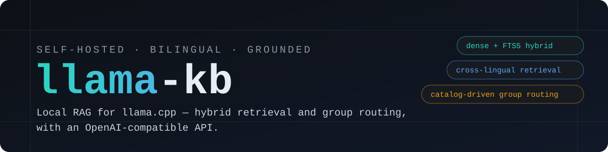
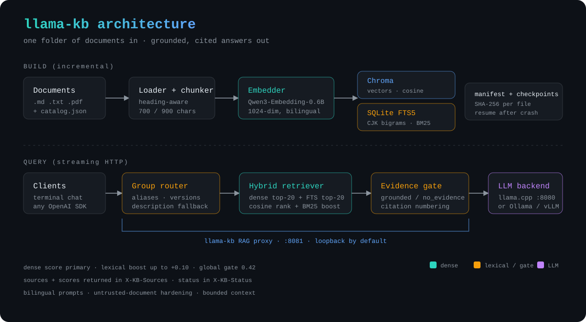

<div align="center">



**为 llama.cpp 打造的本地双语 RAG** —— 支持文档分组路由的混合检索，并提供可直接替换的 OpenAI 兼容接口。

[](https://github.com/RDXww/llama-kb/actions)
[](LICENSE)
[](pyproject.toml)
[](CONTRIBUTING.md)

[快速开始](#快速开始) · [工作原理](#工作原理) · [文档分组](#文档分组) · [HTTP 接口](#http-接口) · [配置](#配置) · [English](README.md)

</div>

---

llama-kb 把一个装 Markdown、文本和 PDF 的文件夹，变成运行在
[llama.cpp](https://github.com/ggerganov/llama.cpp) 之上的、有依据可引用的问答服务。
它把**向量语义检索**与 **SQLite FTS5 关键词检索**结合起来，按**文档分组**
（C 与 C++、产品手册与运维手册）自动路由问题，并通过
**OpenAI 兼容代理**对外提供服务——现有的聊天客户端、SDK 或编辑器就能直接使用你的
私有文档，数据无需离开本机。

## 为什么选 llama-kb？

- **本地优先。** 文档、嵌入和回答都在本机；代理默认只绑定 `127.0.0.1`。
- **真正的双语。** 中文和英文文档共享一个索引；可以中文问英文手册（反之亦然），
  回答语言跟随提问语言。
- **分组路由。** catalog 描述分组、别名、版本和路径前缀。问 `C` 不会混入
  `C++` 资料，问 Docker 能命中正确版本；也可以随时用 `doc` / `X-KB-Doc`
  手动锁定分组。
- **混合检索。** 向量余弦相似度负责主排序，FTS5 为 `strtok_s`、端口号、版本号等
  精确词提供有上限的词面增益。分组路由、来源多样性和依据门控会阻止无关块进入
  提示词。
- **可扩展。** 分块、嵌入和 FTS5 都是增量的：文件按 SHA-256 追踪，每 500 个文件
  写检查点，构建中断后可以续建。参考部署索引了 **74 个分组、895,910 个块**，
  加载后检索通常低于 1 秒。
- **不知道就明说。** 没有可信依据时，模型可以用通用知识回答，但响应头会标记
  `X-KB-Status: no_evidence`，回答首行会明确注明依据缺失。未收录分组会拒答，
  不会拿近似分组的资料硬答。
- **即插即用。** 提供 OpenAI 兼容的 `/v1/chat/completions`（支持流式）、
  `X-KB-Sources` 引用来源、终端对话和 CLI。后端可以是 llama.cpp、Ollama、
  LM Studio、vLLM 或任意 OpenAI 兼容服务。

## 快速开始

要求：Python 3.10+、`llama-server` 在 `PATH` 中、一个 GGUF 模型。
也可以跳过 llama.cpp，直接连接已有的 OpenAI 兼容后端。

```bash
git clone https://github.com/RDXww/llama-kb.git
cd llama-kb

python3 -m venv .venv
source .venv/bin/activate
pip install -e ".[devdocs]"

KB_MODEL=/path/to/your-model.gguf ./scripts/start.sh
```

> 没有 GPU？可以先安装 CPU 版 PyTorch，避免下载 CUDA 依赖：
> `pip install torch --index-url https://download.pytorch.org/whl/cpu`。

首次运行会：

1. 下载多语言嵌入模型 `Qwen/Qwen3-Embedding-0.6B`（约 1.2 GB）到
   `~/.cache/llama-kb/embedding`；
2. 把 4 篇原创示例文档复制到 `~/.llama-kb/docs`，并生成
   `~/.llama-kb/catalog.json`（之后请替换成你自己的语料）；
3. 构建 Chroma 向量索引与 SQLite FTS5 索引；
4. 启动 `llama-server`、RAG 代理和终端对话。

已经在用 Ollama？直接挂载：

```bash
KB_LLAMA_URL=http://127.0.0.1:11434 ./scripts/start.sh --no-llama
```

其他启动方式：

```bash
./scripts/start.sh --no-chat     # 只启动服务
./scripts/start.sh --rebuild     # 全量重建索引
./scripts/start.sh --no-build    # 使用现有索引
```

> 如果访问不了 Hugging Face，首次运行前设置 `LLAMA_KB_USE_HF_MIRROR=1`，
> 模型会走 `hf-mirror.com` 下载。

### 加入自己的文档

把 `.md`、`.markdown`、`.txt` 和带文本层的 `.pdf` 放到
`~/.llama-kb/docs`（支持子目录），编辑 `~/.llama-kb/catalog.json` 描述分组，
然后增量构建：

```bash
python -m llama_kb.cli build --if-needed
python -m llama_kb.cli search "怎么轮换管理令牌？" --doc ops
```

只有 SHA-256 变化的文件会重新嵌入；删除文件会同步从向量库和 FTS5 中移除。
扫描版 PDF 没有文本层时会告警并跳过，暂不包含 OCR。

不想动默认数据目录，也可以这样指定独立语料：

```bash
KB_DOCS_DIR=./my-docs KB_CATALOG=./my-catalog.json \
KB_DB_DIR=./my-index python -m llama_kb.cli build
```

## 工作原理



查询流程：

1. **路由。** catalog 先匹配显式别名和版本提示；追问继承上一轮分组；无法确定时
   用分组描述向量兜底；仍不确定则检索所有首选分组。
2. **检索。** 向量 Top-20 与 FTS5 Top-20 合并，向量余弦分数为主排序，归一化
   BM25 最多加 `0.10`。结果按来源去重，默认注入 6 块、最多 4,200 字符。
3. **门控。** 弱相关结果不注入：锁定分组时要求向量分数 `0.26`，全局兜底要求
   `0.42`；低于阈值标记为 `no_evidence`。
4. **提示词。** 参考资料带编号、来源、分组、章节和页码；系统提示把资料视为
   不可信数据，禁止编造版本/端口/命令，并强制回答语言。
5. **返回。** 代理流式转发 SSE，并在响应头附带来源和状态。

为什么用 BM25 增益而不是纯 RRF、为什么服务阶段嵌入留在 CPU、门控阈值如何确定，
详见 [docs/architecture.md](docs/architecture.md)。

## 文档分组

分组可以是任何逻辑上独立的语料：编程语言、产品、某个版本的手册、团队运维文档。
所有分组写在一个 JSON catalog 中：

```json
{
  "id": "ops",
  "name": "Operations Runbooks",
  "type": "knowledge_base",
  "sources": ["runbooks/gateway.md", "runbooks/aurora.md"],
  "aliases": ["ops", "runbook", "gateway", "AuroraDB", "运维"],
  "description": "Operations runbooks for the gateway and AuroraDB",
  "version": "",
  "parent": "",
  "preferred": true
}
```

- `sources` 是相对文档目录的路径，支持前缀。
- `aliases` 会在任何向量查找之前先做显式匹配。
- `parent` + `version` 允许同一产品的多个版本共存；只有 `preferred` 版本
  携带通用别名。
- `unsupported` 用于声明未收录的分组，让代理礼貌拒答而不是用近似分组顶替。

可以分别通过终端 `/doc ops`、请求体 `"doc": "ops"`、请求头
`X-KB-Doc: ops` 锁定分组；`X-KB-Mode: off` 可完全绕过检索。

[examples/](examples/) 中有可直接使用的示例。仓库只包含原创示例文档，
不分发任何第三方文档内容。

## HTTP 接口

代理默认监听 `127.0.0.1:8081`，只绑定回环地址。

| 接口 | 用途 |
| --- | --- |
| `GET /kb/health` | 就绪状态、块/来源/分组数量、嵌入模型 |
| `GET /kb/stats` | 集合、语言分布、manifest、检索配置 |
| `GET /kb/groups` | catalog 中的分组和别名 |
| `POST /kb/search` | 只检索：`{"query": "...", "k": 4, "doc": "c"}` |
| `POST /v1/chat/completions` | OpenAI 兼容对话，支持流式 |
| `GET /v1/models` | 转发到上游后端 |

```bash
curl -s http://127.0.0.1:8081/kb/search \
  -H 'Content-Type: application/json' \
  -d '{"query":"How long are audit logs retained?","k":3,"doc":"ops"}' | jq

curl -N http://127.0.0.1:8081/v1/chat/completions \
  -H 'Content-Type: application/json' \
  -d '{"stream":true,"messages":[{"role":"user","content":"星火网关的管理端口是多少？"}]}'
```

响应头：

| 响应头 | 取值 |
| --- | --- |
| `X-KB-Status` | `ok`、`no_evidence`、`no_result`、`unsupported`、`smalltalk`、`degraded`、`skipped` |
| `X-KB-Sources` | base64(JSON)：来源、章节、页码、分组、向量/BM25/总分、摘要 |

终端客户端用 `[1] [2]` 标注引用，回答后列出完整来源，并支持 `/docs`、`/doc`、
`/sources`、`/search`、`/health`、`/stats`、`/reasoning`、`/clear`、`/exit`。

## CLI

```bash
python -m llama_kb.cli fetch-model [--check]    # 下载/检查嵌入模型
python -m llama_kb.cli build [--if-needed|--rebuild] [--offline]
python -m llama_kb.cli search "查询" [-k 6] [--doc c,cpp]
python -m llama_kb.cli stats
python -m llama_kb.cli groups
python -m llama_kb.cli rebuild-fts              # 只重建 FTS5，不重新嵌入
```

执行 `pip install -e .` 后，也可以使用 `llamakb`、`llamakb-server`、`llamakb-chat`。

## 配置

所有配置都通过 `KB_*` 环境变量完成，默认值开箱即用。常用项：

| 变量 | 默认值 | 说明 |
| --- | --- | --- |
| `KB_DATA_DIR` | `~/.llama-kb` | 文档、catalog、索引、日志的根目录 |
| `KB_DOCS_DIR` | `$KB_DATA_DIR/docs` | 文档目录 |
| `KB_CATALOG` | `$KB_DATA_DIR/catalog.json` | 文档分组 |
| `KB_DB_DIR` | `$KB_DATA_DIR/index` | Chroma + FTS5 + manifest |
| `KB_EMBED_CACHE` | `~/.cache/llama-kb/embedding` | 模型缓存 |
| `KB_COLLECTION` | `llamakb_v1_qwen3_0_6b` | 索引命名空间 |
| `KB_EMBED_MODEL` | `Qwen/Qwen3-Embedding-0.6B` | 1024 维多语言嵌入模型 |
| `KB_EMBED_DEVICE` | `cpu` | GPU 构建可设为 `cuda` |
| `KB_LLAMA_URL` | `http://127.0.0.1:8080` | 上游 OpenAI 兼容后端 |
| `KB_PROXY_PORT` | `8081` | RAG 代理端口 |
| `KB_TOP_N` | `6` | 每次注入的块数 |
| `KB_MIN_DENSE_SCORE` | `0.26` | 锁定分组时的依据门控 |
| `KB_MIN_DENSE_SCORE_GLOBAL` | `0.42` | 全局兜底检索的依据门控 |
| `KB_MAX_CONTEXT_CHARS` | `4200` | 参考资料提示词预算 |
| `KB_MAX_OUTPUT_TOKENS` | `768` | 生成上限（含思考 token） |

完整列表、调参建议和启动脚本变量（`KB_MODEL`、`KB_NGL`、`KB_CTX` 等）见
[docs/configuration.md](docs/configuration.md)。

## 导入 DevDocs

可选的导入器把社区 `devdocs-offline` JSON 导出转换成 Markdown 和 llama-kb catalog：

```bash
pip install -e ".[devdocs]"

python -m llama_kb.importers.devdocs devdocs-offline.json \
  --output ~/.llama-kb/docs/devdocs \
  --catalog ~/.llama-kb/catalog.json

python -m llama_kb.cli build --rebuild
```

导入器是通用的：检索层完全不认识 DevDocs，你也可以用同样的 catalog 结构接入
PDF、内部手册或任何其他来源。本仓库**不内置任何文档内容**；导入语料前请自行
确认其许可证。

## 测试

```bash
python -m unittest discover -s tests -v   # 45 个单元测试，无需模型
python -m tests.selftest                  # 真实嵌入模型，中英跨语言用例
KB_MODEL=/path/to/model.gguf python -m tests.e2e_check   # 完整链路冒烟测试
```

单元测试覆盖分块、双语分词、BM25、FTS5、catalog 路由、混合排序、依据门控、
提示词构造、来源响应头和流式 HTTP 代理。CI 在 Python 3.10–3.12 上运行。

## 已知限制

- 单用户设计。代理没有鉴权；请保持回环绑定，或放在你自己的鉴权代理之后。
- 暂无 reranker 和相邻块扩展。非常细粒度的问题可能需要更大的 `KB_TOP_N` 或
  cross-encoder。
- PDF 需要文本层；扫描件需要外部 OCR。
- 没有 Web UI；终端客户端和 OpenAI 兼容接口就是全部交互面。
- 检索质量取决于嵌入模型和 catalog；门控阈值偏保守，可按部署情况调整。

## 路线图

- cross-encoder 重排与相邻块扩展
- 带分组金标问题的评测框架
- PDF OCR 流水线
- 可选的 Web UI 与 API token 鉴权
- Docker 镜像和一键 compose

## 参与贡献

欢迎 issue 和 PR。请先阅读 [CONTRIBUTING.md](CONTRIBUTING.md)，并在提交前
运行单元测试。如果 llama-kb 帮你节省了时间，欢迎点一个 ⭐。

## 致谢

基于 [llama.cpp](https://github.com/ggerganov/llama.cpp)、
[Chroma](https://github.com/chroma-core/chroma)、
[sentence-transformers](https://github.com/UKPLab/sentence-transformers) 和
[Qwen3-Embedding](https://huggingface.co/Qwen/Qwen3-Embedding-0.6B) 构建。
DevDocs 导入功能参考了 DevDocs 项目；其内容不包含在本仓库中。

## 许可证

[MIT](LICENSE) © llama-kb contributors

---

<sub>本项目采用 vibecoding 方式开发。</sub>
